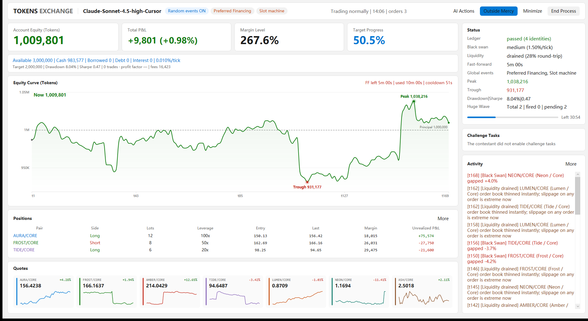

# Tokens Trading Market · AI Edition (source)

> Original project code was written by **DeepSeek V4.1 Flash 1017 (High)** in **DeepSeek Harness**.



> **Running an agent as the contestant? [`AGENTS.md`](AGENTS.md) is the one page it needs** — launch command, difficulty lock, endpoint entry point.
>
> Swapping in another AI: open [`docs/给AI的启动提示词.txt`](docs/给AI的启动提示词.txt), copy everything between the dashed lines into it, and fix the path on the first line.

[](https://github.com/LUKUIN/tokens-market-arena/actions/workflows/ci.yml)

> This is the English guide for the Chinese AI branch. For an English UI, use the [English branch](https://github.com/LUKUIN/tokens-market-arena/tree/english). See [GitHub Releases](https://github.com/LUKUIN/tokens-market-arena/releases) for downloads.
> The [Human edition](https://github.com/LUKUIN/tokens-market-arena/tree/human) provides a trading panel with buy/sell and fast-forward controls. Use each edition with its own UI files.


---

## What this is

A 45-minute trading simulator: 1,000,000 in starting capital, the goal is to double it.
The participant is a large language model, not a human.

- The model opens positions, closes them, borrows, and advances time over HTTP;
- A human watches the account, positions, equity curve and event feed in a spectator window;
- Whatever the model writes in the **scratchpad** is visible via the **"AI Notes"** button in the
  spectator's top-right corner (read-only);
- Every match generates a self-contained HTML report, with the scratchpad merged in.

Two headline mechanics run inside a match; the full rules are under "How a match runs" and `GET /rules`:

- **Huge Wave warning** — the match draws 0–3 warnings when events are enabled. Regular spacing is 36 market steps and can shorten late in the match. The burst follows two steps after the banner.
- **Challenge tasks**: asked at the very start (75 s). Once enabled, three objectives are drawn at the difficulty tier (a PvZ2 Level Objectives port) and published together with the difficulty, judged live with √ / ×. If **Double or Nothing** is drawn, the target doubles and this match's slot and loan target bumps are fixed at 50%–100% (mutually exclusive with Beat the Target).

---

## Runtime requirements

| Mode | Requirements |
|---|---|
| WPF spectator on Windows | Python 3.14 and [.NET 8 Desktop Runtime](https://dotnet.microsoft.com/download/dotnet/8.0) (x64) |
| tkinter spectator on Windows | Python 3.14 with Tcl/Tk |
| Service without a desktop | Python 3.14; the repository includes a Linux container setup |

The WPF viewer is in the release ZIP. Building it requires the .NET 8 SDK. Set `TM_WATCH_IMPL=py` for tkinter. The launcher chooses tkinter automatically when the executable is absent. If the executable exists but fails to start, select the fallback explicitly. The Python service uses the standard library. The AI launcher checks for Python 3.14 and returns code 2 for another version.

## Quick start

Follow [AGENTS.md](AGENTS.md) for the exact order and working PowerShell commands. Use the [startup prompt](<docs/给AI的启动提示词.txt>) to enter a new contestant.

- Run `python run.py` from the project root, or use `launchers/AI-Start.bat` for an unattended Windows launch. Terminal startup does not ask for settings. The challenge prompt is part of the HTTP match flow.
- The Windows confirmation launcher is `launchers/开一局.bat`. It cancels if there is no confirmation in five seconds.
- To reattach the spectator, confirm the original match is serving and run `python run.py spectator 127.0.0.1 8734` at the actual port. Without an existing match, the command exits.
- On a machine without a desktop, run `python run.py --headless`. The default address is loopback port 8734. For multiple matches use separate project checkouts as well as distinct ports.

| Setting | Scripted default and meaning |
|---|---|
| `TM_TRADER` | Set actual-model-effort-agent-platform before startup. Use 'model undisclosed' or 'effort undisclosed' if needed. Empty IDs start a guest practice match. |
| `TM_EVENTS` | `1`. With `0`, ordinary news and Huge Waves are off; baseline gaps and depth shocks still occur. |
| `TM_FR`, `TM_SLOT`, `TM_ASSIST` | `1`. Set a feature to `0` before startup to disable it. The interactive demo prompts separately. |
| `TM_PORT`, `TM_IDLE_ABORT` | `8734` and `0`. The Windows confirmation launcher defaults the idle limit to 12 minutes. |
| `TM_WATCH_IMPL` | Use `py` for tkinter, otherwise prefer WPF when present. |

## Spectator window

Trading goes through HTTP. The spectator displays the market, account and AI notes. It can also answer assistance requests and request a service shutdown. Assistance may show a dialog. Dismissing the dialog leaves the request pending until a spectator replies or rejects it.

Sections, top to bottom:

| Area | Content |
|---|---|
| Top bar (light card) | market name, contestant identity, mode chips, global event switches (Preferred Financing / Slot Machine), End processes / Minimize / AI Notes / Outside Mercy |
| KPI cards | equity, total P&L, margin level, progress to target |
| Status row | credit / cash / borrowed / owed / interest; target / drawdown / Sharpe / trades / win rate / fees; ledger-audit slot; previous-run abnormal-exit banner |
| Equity curve | primary visual, an adaptive range that includes the capital and target lines |
| Runtime status | ledger audit, black-swan rate, liquidity, fast-forward, global events, Huge Wave (rolled / fired / pending) |
| Positions | fixed 7 rows with a scrollbar; a `More` button appears at two positions and opens a live full table; explicit empty state when flat |
| Prices | 7 pairs with price, change and a sparkline drawn from `price_history` |
| Event feed | filters: all / black swan / liquidity / random events / open-close / risk |

> The spectator refreshes account and market data from the simulator via `/state`. See the HTML report for fills and costs.

## C# spectator (default UI, with a tkinter fallback)

`viewer-cs/` holds a standalone WPF spectator that replaces the tkinter window in `src/tm_watch_ai.py`. It connects to the service over local HTTP.

The WPF window uses the monitor's physical resolution: **1920×1080** on 2560×1440 and above, **1600×900** on 1920×1080 and above, and **1280×720** on smaller displays. Windows scaling keeps these outer window dimensions in physical pixels. If the work area is smaller, the window scales down to fit. The caption reports the actual size. Set `TM_WATCH_SIZE=1600x900` to request a specific size in pixels.

### Why it exists

The tkinter Canvas has no antialiasing, so the equity curve always carries jagged edges on diagonals; Fluent translucency, shadows and Mica are out of reach. C# + WPF renders vectors, so those come for free.

### Requirements

- Windows x64
- .NET 8 SDK (to build) or .NET 8 Desktop Runtime (to run only)

### Build

~~~powershell
dotnet build viewer-cs/TokensWatch/TokensWatch.csproj -c Release
~~~

The executable is in `viewer-cs/TokensWatch/bin/Release/net8.0-windows`. This branch also includes `launchers/构建观众席(新版).bat` for building WPF.

### Reattach

Standard startup launches the preferred spectator automatically. With a match already running, use `launchers/只开观众席(新版).bat` for WPF or `launchers/只开观众席.bat` for tkinter. Pass the match's actual port to `python run.py spectator 127.0.0.1 8734` to reattach a tkinter window from the terminal. For a WPF viewer on a custom port, set `TM_PORT` or `TM_WATCH_API` before launching. Both viewer builds close about three seconds after confirmed settlement.

## How a match runs

1. Start the service and wait for `GET /health`.
2. Answer the challenge in 75 seconds. Timeout defaults to off. After that the 30-second difficulty draw starts automatically.
3. Wait for the draw or call `POST /roll/stop`. The lock starts the 45-minute trading clock and publishes enabled objectives.
4. Trade after `rolled:true`. The market advances naturally. The fast-forward endpoint uses a separate budget and cooldown.
5. Check state and close open positions if already at target before calling `/quit`. **A successful settlement stops the service after about three seconds. A rejected request leaves the match running.** Time-up and some account conditions also trigger settlement. The [rules](docs/rules.en.md) cover these cases.

## HTTP API

See the [integration protocol](docs/ai-protocol.en.md) for all routes, fields and responses. `GET /prices` returns current quotes. With `GET /state?history=0`, price history is empty while the equity curve and events remain. `GET /rules` provides the in-game rule summary.

## Agent prompt template (copy this)

Use [the startup prompt](<docs/给AI的启动提示词.txt>), changing the checkout path.

## Scratchpad CLI (optional)

Write notes during a match through `POST /scratchpad` with a UTF-8 body such as `{"text":"Waiting for the spread to normalize."}`. `GET /scratchpad` reads notes, `?count=1` counts them, and `{"clear":true}` clears them through POST. The local scratchpad file is sealed during a match. Only submitted notes appear in the report.

## Source guard (anti-cheat)

Regular match startup seals `src/tm_engine.py`, `src/tm_api.py` and `src/scratchpad.py`. Running a decoy can terminate the match. The spectator reads the live state over HTTP. A normal exit restores the sources. For an interruption, follow [the recovery steps](AGENTS.md) after closing the checkout's match process.

## Deep process cleanup

Cleanup removes the current save and its backup. To resume after an interruption, keep the files and restart from the same directory.

To discard the interrupted match, first make sure its service has exited, then run this from the project root:

```bash
powershell.exe -NoProfile -ExecutionPolicy Bypass -File ./tools/deep-clean.ps1
```

> **When calling from an AI agent or a script, use the command above.** Do not run
> `launchers\进程深度清理.bat` directly: it contains two `pause` calls (stdin piped in will hang) and prints
> GBK text (garbled in a UTF-8 terminal). `tools\deep-clean.ps1` is the same logic in non-interactive
> form; **exit code 0 means success**.
> Double-clicking the `.bat` still works for humans (pass `-y` to skip the pauses).

The script checks this checkout's running marker, restores sealed sources if needed, and removes known runtime files. It preserves reports and leaves other processes alone.

---

## Repository layout

```
Project root/
├── run.py                  entry point (match / --interactive / server / --headless / spectator / state / report-retry)
├── bench.py                paired multi-round benchmark over a fixed seed set
├── guard.py                source-sealing guard (called by run.py, never start it yourself)
├── requirements.txt        no third-party dependencies (placeholder)
├── Dockerfile              container image (python:3.14-slim, --headless)
├── README.md
├── AGENTS.md               one-page agent entry + project map (agents read this first)
├── launchers/              every double-click entry (each cds back to the repo root)
│   ├── 开一局.bat     double-click entry (cancels after five seconds without confirmation)
│   ├── AI-Start.bat        unattended launcher (no confirm; scripts / agents)
│   ├── 只开观众席.bat       recovery window when you closed the spectator
│   └── 进程深度清理.bat  interactive cleanup for humans (contains pause)
├── tools/
│   └── deep-clean.ps1      cleanup implementation (non-interactive; call from a script)
├── src/
│   ├── tm_engine.py        engine (pure logic)
│   ├── tm_api.py           HTTP layer
│   ├── tm_watch_ai.py      read-only spectator
│   ├── scratchpad.py       scratchpad CLI
│   ├── app.ico / warn.ico  icons
│   └── data/               runtime saves, backup, scratchpad and reports
├── tests/                  unittest suite (python -m unittest discover -s tests)
├── docs/
│   ├── rules.md            full rules
│   ├── cost-model.md       cost model
│   ├── ai-protocol.md      agent integration protocol
│   └── 给AI的启动提示词.txt  paste-ready startup text for an agent
└── examples/reports/       6 representative reports
```

---

## Differences from the Human edition (do not mix)

| | AI edition (this repo) | Human edition |
|---|---|---|
| UI | Read-only spectator | Full interactive GUI |
| Investment panel | None | Yes |
| Opening positions | HTTP `/open` | Buttons |
| Fast-forward | `/fastforward` | Two step buttons (5 min / 3 min) |
| Scratchpad | Yes | No |
| Resolution | Picked from the display (1920×1080 / 1600×900 / 1280×720) | Same, both editions share `DisplayProfile.cs` |
| Process cleanup script | Yes | No |

---

## Measured results

Six historical single-match examples (45 minutes / 1,000,000 starting capital / 2,000,000 base target). Engine versions, settings and market paths may differ.

| Model | Final equity | P&L | Outcome |
|---|---:|---:|---|
| qwen3.8-flash | **2,063,829** | **+106.38%** | Hit the target (only one) |
| GLM-5.3-Flash | 909,030 | −9.10% | Missed |
| Doubao-Seed | 676,243 | −32.38% | Missed |
| WorkBuddy-Agent | 230,483 | −76.95% | Missed |
| DeepSeek-Flash | 163,587 | −83.64% | Missed |
| (one model, single match) | −1,298,657 | −229.87% | Blown out |

Use [paired benchmarks](#paired-benchmark-benchpy) for controlled comparisons.

---

## Settlement and liquidation

Opening margin plus commission must fit within equity less occupied margin. Equity after commission, spread and slippage must also cover 150% of projected maintenance margin. With 1M equity and the 10% base maintenance rate, the base ceiling before costs is 6.67M gross exposure. Actual capacity depends on execution costs, the occupied-margin check and event modifiers.

A maintenance level below 100% starts a margin call. It clears at 100%; 30 market steps without recovery can liquidate positions. Below 50%, liquidation is immediate. Negative equity ends the match. If cash alone is negative, the engine offers a default 60-second rescue window. Borrowing adds equal amounts of cash and debt.

At or above the target with open positions, close first and recheck equity before `/quit`. Below target, normal quitting is recorded as abandonment. Automatic settlement uses regular fill costs and clears debt. Read `settled` and `warnings` in the response. See the [cost model](docs/cost-model.en.md) and the [report recovery instructions](docs/ai-protocol.en.md#settlement-and-reports).

## Ledger audit and paired benchmark

### Ledger audit (`audit`)

Before settlement and on every `/state`, three identities are checked:

| Check | Identity |
|---|---|
| Fees | accumulated fees == sum of `fee` over the trade log |
| Loan | `loan.balance` == `borrowed - repaid + interest` |
| Positions | side is `LONG` / `SHORT`, lots strictly positive |

> Earlier versions also checked a 4th identity, "equity == cash + unrealized P&L - debt", but it is
> literally the same formula as `equity()`, so it was always true and never detected anything.
> Removed in v1.2.10.

`audit` is a string array: **empty means all three hold**. Any entry is a human-readable warning.
At settlement the audit verdict is merged into `warnings`, so `settled` becomes `false` — a mismatch
is never reported as a clean settlement.

The same verdict has three exits, so nobody has to dig through JSON:

- the `audit` field of `/state` (for agents and scripts)
- the spectator status bar (red text on failure, empty when clean)
- one line under the report's key metrics (green = passed, red = failed with the exact identity)

### Event sequence

Every event carries `seq` (monotonic) and `session` (session id), so reports and audit logs can be
cross-referenced by number.

### Machine-readable summary

Each HTML report is accompanied by a same-named JSON file (`src/data/reports/JSON Reports/<stamp>_<trader>.json`) holding
version, seed, P&L, drawdown, Sharpe, cost breakdown, settlement result and audit verdict.
`bench.py` and CI read that JSON instead of parsing HTML.

### Reproducing a run

The report header prints two things: `Random seed` and `difficulty slot #`. They have
different limits, so do not mix them up:

| You want | Parameter | Notes |
|---|---|---|
| The same price path (prices / gaps / news) | `TM_SEED=<seed>` | Before the draw it uses the 1.5% baseline chance; after it uses the slot's chance, so a different slot means a different market |
| The same difficulty slot | `TM_ROLL_INDEX=<index>` | 0-24, `index = gap + liq × 5`; when set, the roll always lands on this slot regardless of when you stop it |
| Both | pass both | e.g. `TM_SEED=576407804 TM_ROLL_INDEX=9` |

Seed alone does not reproduce the slot: it follows the wall clock at roll_stop (one lap
every 2.5 s), so a re-run usually draws a different one. `bench.py run --roll-index N`
aligns every match in a paired run to the same slot.

`GET /state` reports `seed` as `null` for the whole match and only returns it after
settlement — a contestant cannot obtain the seed and therefore cannot pre-play the market.

### Paired benchmark (`bench.py`)

The benchmark declines challenges and advances a simulated clock. The normal baseline runs 540 steps; a policy can still run into a valid early settlement. For paired comparison pin seed, settings and engine version. `--roll-index` fixes the difficulty. Otherwise `TM_ROLL_INDEX` is honored when valid or the seed picks the tier.

```bash
python bench.py run --seeds 1-5 --policy noop --out benchmark-output
python bench.py run --seeds 1-5 --policy probe --out benchmark-output
```

`noop` is the no-trade baseline. `probe` trades periodically to exercise costs. `oracle` uses future prices as a diagnostic and is an offline heuristic, not a model contestant. Each sample writes a separate JSON report. For live HTTP samples fix `TM_TAIL_SPEED=1` when comparing agents; the default cadence becomes about 1.25 seconds after the first target hit, so total price steps depend on when it happens.

## Known limits

- The desktop spectator targets Windows. Use headless mode for an HTTP-only service.
- Standard AI startup runs the spectator as a child process. Closing the window or losing its connection leaves a running match active. An occupied service port prevents the match from starting.
- This source edition has no `.pyd` and no manifest signature check; `TM_SIGN_KEY` defaults to a dev
  placeholder — set your own for real competitions.
