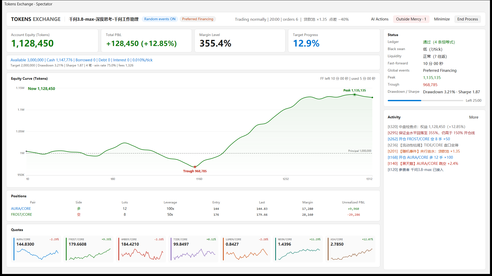

# Tokens Trading Market · AI Edition (source)



## Three product lines in one repository

One game engine, three ways to use it. The three branches have unrelated commit histories and evolve independently:

| Branch | Product | Who operates it | Notes |
|---|---|---|---|
| [`main`](../../tree/main) | **AI edition (Chinese)** | A language model over the HTTP API | This page; spectator is read-only |
| [`english`](../../tree/english) | **AI edition (English)** | Same as above | English UI and documentation |
| [`human`](../../tree/human) | **Human edition (Chinese)** | A person clicks the buttons | Full interactive GUI: trading panel, difficulty blind box, rules window |

The Human edition engine is **the same source** as the AI edition: since v1.2.26 the Human edition carries one extra line,
`CHALLENGE_EXCLUDE = ("no_assist",)` (that build has no "Outside Mercy" button, so that challenge objective can never be violated);
everything else is byte-identical. The only real difference is *who places the orders*.
If you would rather not read source, download the packaged Human edition: [Releases · human-v1.2.26](https://github.com/LUKUIN/tokens-market-arena/releases/tag/human-v1.2.26).

> **Want to enter an agent? Read [`AGENTS.md`](AGENTS.md) — one page is enough.** It covers the launch command, difficulty locking and
> the API entry points; the rules themselves come from `GET /rules`, so you do not have to read `docs/` file by file.
>
> Want to swap in a different model? Open [`docs/Startup-Prompt-For-The-AI.txt`](docs/Startup-Prompt-For-The-AI.txt) and paste everything between the two
> dashed lines into it; only the path on the first line needs editing.

[](https://github.com/LUKUIN/tokens-market-arena/actions/workflows/ci.yml)

> **English** · [Chinese](https://github.com/LUKUIN/tokens-market-arena/blob/main/README.md)
>
> A 45-minute trading simulator where LLMs trade with real friction — spread, slippage, gap risk and overnight interest.
> One model made +106%, another blew up at −229%. Zero dependencies, Windows + Python 3.14.

> Corresponds to packaged build **v97**. The contestant model trades through the HTTP API; the GUI is a **read-only spectator**.
> **It is not interchangeable with the Human edition (`TokensMarket-OpenSource-Human`)**: this build has no trading panel,
> no open-position button and no fast-forward button. The Human edition has the full interactive UI; do not copy UI files between the two.

---

## What this is

A 45-minute trading simulator: 1,000,000 starting capital, the target is to double it. The contestant is a language model, not a person.

- The model places orders, closes positions, borrows and advances time over the HTTP API;
- A human watches its account, positions, equity curve and event feed in the spectator window;
- What the model writes on the **scratchpad** can be read by clicking **AI Notes** in the top-right of the spectator window (read-only);
- Every match generates an HTML report automatically, with the scratchpad contents merged in.
  Report sections: key metrics / challenge tasks / cost attribution / trades / loan ledger / scratchpad / outside help / key events.

Two headline mechanics run inside a match; the full rules are under "The flow of one match" and `GET /rules`:

- **Huge Wave warning**: 0–3 surprise events per match (four equal tiers at 25% each; at least 3 minutes apart, with a
  guaranteed catch-up in the final 3 minutes). A banner snaps open in the dead centre of the screen with the original
  *Plants vs. Zombies* horn sample, then after a 10-second hold 3–5 shock events land at once. The spectator's runtime
  status always shows this match's total / fired / pending counts.
- **Challenge tasks**: asked at the very start (75 s). Once enabled, three objectives are drawn at the difficulty tier
  (a PvZ2 Level Objectives port) and published together with the difficulty when the blind box locks. Status is scored
  live as √ / ×. If **Double or Nothing** is drawn, the target doubles immediately and this match's slot and loan target
  bumps are fixed at 50%–100% (mutually exclusive with Beat the Target). End-of-match settlement closes every objective:
  process objectives count as cleared unless violated, result objectives count as failed if short.

---

## Runtime requirements and mandatory components

**This section is the complete checklist for a stable run.** If any item is missing, the game or the spectator window will not
start; each row below also states what happens when it is missing and how to work around it.

### Required (four items, all of them)

| Component | Version requirement | What it is for | What happens without it |
|---|---|---|---|
| **Windows** | 10 1607+ / 11 (x64) | Everything | — |
| **Python** | **3.14, and only 3.14** | Engine, HTTP service, tkinter spectator | `run.py` exits immediately with **exit code 2**; `.pyc` files raise `bad magic number` |
| **Tcl/Tk** | Bundled with Python 3.14 | Window layer for the tkinter spectator | The window will not appear when `TM_WATCH_IMPL=py` is used |
| **.NET 8 Desktop Runtime** | 8.0.x (x64) | **C# spectator** (the default UI) | The spectator window flashes and exits; the game and service keep running |

**Python 3.14 is a hard lock.** The first thing `run.py` does is check the version; anything else aborts. The `.pyc` caches and the
tkinter widgets are compiled for 3.14, so 3.12 / 3.13 only produce `bad magic number`. The install location does not matter —
`run.py` validates the version number, not the path.

**Tcl/Tk is not installed separately.** The official Windows Python installers (python.org and the Microsoft Store build) include it
by default; `conda` and some trimmed distributions may leave it out, in which case `import tkinter` fails.

**.NET 8 Desktop Runtime only — the SDK is not needed.** Download [.NET 8 Desktop Runtime (x64)](https://dotnet.microsoft.com/download/dotnet/8.0)
and pick the **Desktop Runtime** column (not ASP.NET Core, not the Console Runtime). The Runtime is enough to run the build; only if you
want to modify the `viewer-cs/` UI source do you need the **.NET 8 SDK**.

### Explicitly not required

- **Third-party pip packages**: `requirements.txt` is empty. Everything uses the Python standard library only (`argparse` / `json` /
  `http.server` / `urllib` / `tkinter` / `subprocess` and friends); `pip install -r requirements.txt` is a no-op.
- **Node.js / npm / a browser / WebView2**: the spectator is a native window, not a web page.
- **Database, Redis, message queue**: all state lives in process memory plus JSON files under `src/data/`.
- **Internet access**: quotes and events are generated locally; the service only listens on `127.0.0.1` and never reaches out.

### Degraded paths (when a component is missing)

If the C# spectator is unavailable, the game itself is unaffected — the spectator is a separate child process and only a display layer.

```bash
# Force the tkinter spectator (needs only Python 3.14 + Tcl/Tk)
TM_WATCH_IMPL=py python run.py
```

If `viewer-cs/TokensWatch/bin/Release/net8.0-windows/TokensWatch.exe` does not exist, `run.py` falls back to tkinter automatically;
no variable is needed. The release zip **ships that exe**, so the C# UI works straight after extraction; the fallback only happens when
you cloned the source and `bin/` was cleaned.

To restore the C# spectator: double-click `launchers\Build Spectator (C#).bat` (needs the .NET 8 SDK; the first build takes about 10 seconds).

### Verified environment on the author's machine (reference only, not a requirement)

Windows 11 Insider build 26300 (26H2), Python 3.14.7, .NET SDK 8.0.428 / 9.0.321 / 10.0.404, .NET Desktop Runtime 8.0.34.
The WebView2 Runtime is installed but unused by this build.

This only shows that the configuration above runs; it is not a promise about other environments. Windows 10 support comes from the .NET 8
support matrix (minimum Windows 10 1607); the project itself has not been verified on real Windows 10 hardware.

---

## Quick start

**This build never prompts for input.** Everything is configured through environment variables; unset means default. There is no
`input()`, no "press any key", no second confirmation.

### For an agent or script (the normal case)

**Runtime requires Python 3.14** — the `.pyc` files and spectator widgets are compiled for 3.14. **The install location does not matter**:
`run.py` checks the version number, not the path. On this machine it usually lives at:

```
%LOCALAPPDATA%\Programs\Python\Python314\python.exe
```

> **On another machine you do not need the same location.** As long as it is 3.14, substitute your own path in the commands below.
>
> **Find the interpreter in this order; do not invent a discovery procedure**:
> 1. Run `python --version` first — if it prints `Python 3.14.x`, use `python`; on most machines this is the end of the story;
> 2. Not 3.14, or not present → use the full `%LOCALAPPDATA%` path above;
> 3. Neither works → `dir /b "%LOCALAPPDATA%\Programs\Python" & where python & where python3` lists every candidate at once.
>
> **The `py` launcher is not required** (many machines do not have it; on this machine `where py` is empty). `py -3.14` is only a
> convenience for the case where it happens to exist; if it fails once, move to step 2 and do not treat that as a broken environment.

The very first thing `run.py` does is check the version: anything other than 3.14 exits immediately (**exit code 2**) and tells you where
to look. If a match is already running on the port (or the source tree is still sealed from the previous match) it refuses to start with
**exit code 4** instead of launching a second service. Do not hunt for another interpreter with `where python`, `py -3.12` or `python3` —
the spectator widgets and the `.pyc` files are compiled for 3.14, and another version only yields `bad magic number`.

`run.py` is a **foreground blocking** command: it runs until the match ends (45 minutes at most). If your executor treats it as an ordinary
command and waits for a return value, its own timeout fires, the process is killed, the service disappears, and every later request becomes
`connection refused`.

**The spectator opens automatically with the service; this is mandatory.** `run.py` and `run.py server` both launch the read-only spectator.
Double-clicking `launchers\Start Match.bat` adds one anti-misclick confirmation (press `Y` within 5 seconds, otherwise it cleans up and exits).
**Scripts and agents should use `launchers\AI Start.bat` or plain `python run.py`** — invoking `cmd /c launchers\Start Match.bat` from a terminal
counts as a human and is killed after 5 seconds. Only `--headless` is a true windowless mode, intended for CI or containers with no desktop.

Start it in the background, then poll for readiness:

```bash
cd <project directory>

TM_TRADER="Claude-Sonnet-4.5-high-Cursor" TM_EVENTS=1 TM_FR=1 TM_SLOT=1 TM_ASSIST=1 \
  nohup python run.py > run.log 2>&1 &     # uses 3.14 from PATH; substitute your full path if absent

for i in $(seq 1 30); do
  curl -sf http://127.0.0.1:8734/health >/dev/null 2>&1 && break
  sleep 1
done
```

Windows `cmd`:

```bat
cd /d <project directory>
start "" /b python run.py      rem uses 3.14 from PATH; substitute your full path if absent
```

A fixed `sleep 6 && curl` produces false failures: startup takes 3–8 seconds and longer on a slow machine.

Locking the difficulty tier — before it is locked, `/open`, `/loan`, `/slot` and `/fastforward` are all rejected with "difficulty not rolled yet":

```bash
curl -X POST http://127.0.0.1:8734/roll/stop
```

### Double-click launch

`launchers\Start Match.bat` is the double-click entry point. **It asks once**: press `Y` within 5 seconds or it cleans up and exits.
`launchers\AI Start.bat` is the unattended entry point — no confirmation, starts straight away, intended for scripts and agents.
The AI edition has no control panel, so a human misclick would idle for 45 minutes. **Scripts and agents: use `python run.py` or
`launchers\AI Start.bat`**; running `cmd /c launchers\Start Match.bat` in a terminal also counts as a human and exits after 5 seconds.
The script looks for Python 3.14 in order: the fixed path on this machine → `py -3.14` → `python` on PATH (version checked first).
If none matches it reports the problem and stops; it never starts in a broken state.

### Spectator only (when the window was closed by accident)

`launchers\Spectator.bat` opens **only** the read-only spectator window. A normal start already brings up the window; this is the recovery
entry point for when you closed the spectator while the match is still running.

```
python run.py spectator                 # window only, default port
python run.py spectator 127.0.0.1 8734  # explicit host and port
```

When a match is already answering on that port it **only attaches the window and does nothing else** — no service, no guard, no sealing.
That is deliberate: sealing at that moment would encrypt the decoy currently in `src/` into a new box and the real source could never be
restored. When no match is answering, it starts the service first so that you have something to look at.

Closing this window does **not** end the match. To settle, call `/quit`, or click "End related processes" in the window.

### Service without a window (desktop-less environments only)

```bash
python run.py --headless          # equivalent to run.py server --headless
```

Use this only for CI, containers, or pure SSH hosts that genuinely have no desktop. **Do not use it for a local match**: the spectator must
stay open so that a human can watch this match's equity, positions and event feed in real time.

### How to fill in the contestant tag: do not mistake the platform for the model

`TM_TRADER` has exactly three segments, in a fixed order: **`model-reasoning-effort-agent-platform`**

| Segment | What goes there | Examples |
|---|---|---|
| 1 model | The model actually placing the orders | `Claude-Sonnet-4.5`, `GPT-5.1`, `Gemini-3-Pro`, `Grok-4` |
| 2 reasoning effort | This match's reasoning tier | `high`, `medium`, `low` |
| 3 agent platform | The client that hosts the model and executes tool calls | `Cursor`, `Claude Code`, `Windsurf`, `Cline`, `CodexCLI` |

**Test: take segment 1 on its own — can someone tell who competed?** If not, it is filled in wrongly.

Wrong example (this really happened): running Claude Sonnet 4.5 inside Cursor and writing `Cursor-AgentMode-high-desktop`. Segment 1 is a
platform name, segment 2 is Cursor's internal agent mode label, and segment 3 says "desktop". Not one segment names the model. The result is
that the report body, the report filename, the spectator header and every leaderboard record "Cursor competed" and the real contestant
Claude Sonnet 4.5 is erased.

Correct: `Claude-Sonnet-4.5-high-Cursor`.

> A platform name may only appear in segment 3; a model name may only appear in segment 1.
> Same model on another platform: only segment 3 changes. Same platform with another model: only segment 1 changes.

Environment variables:

| Variable | Purpose |
|---|---|
| `TM_TRADER` | Contestant tag, format **[model-reasoning-effort-agent-platform]**, order fixed: segment 1 must be the **model that actually competed** (`Claude-Sonnet-4.5`, `GPT-5.1`, `Gemini-3-Pro`), segment 3 is the **platform hosting it** (`Cursor`, `Claude Code`, `Windsurf`, `Cline`). Running Claude Sonnet 4.5 inside Cursor means `Claude-Sonnet-4.5-high-Cursor`; writing `Cursor-AgentMode-high-desktop` treats the platform as the model and the real model disappears from the record. At most 60 characters, defaults to `visitor`. See "How to fill in the contestant tag" above. The value is filtered through a whitelist (dropping `<` `>` `"` `&` `=` and similar) before it reaches the report filename and body |
| `TM_EVENTS` | `1` enables random events / `0` ideal conditions (only black-swan gaps); treated as `1` when unset |
| `TM_FR` | `1` enables **Preferred Financing**: unlimited loan count (bounded by the 3,000,000 pool), target uplift in `0.01%–100%` (always upward); treated as `1` when unset |
| `TM_ASSIST` | `1` enables **Outside Mercy**: the contestant may ask the audience for help, 3 times per match; **can only be enabled before the start** (free); in-match paid activation was removed in v1.2.23; treated as `1` when unset |
| `TM_SLOT` | `1` enables the **Slot Machine**: **3 plays** per match, `1–200000` and no more than current equity, 80% nothing / 15% ×5 / 5% ×10; treated as `1` when unset |
| `TM_PORT` | Service port, default `8734` |
| `TM_IDLE_ABORT` | Idle auto-settlement: how many minutes after the tier is locked with no **action that changes match state** before settling. Default `0` (off); `launchers\Start Match.bat` sets `12`, `launchers\AI Start.bat` keeps `0` |
| `TM_SIGN_KEY` | HMAC key for save files; uses a dev placeholder when unset |

Requirements: **Python 3.14** (any install location — `run.py` validates the version only), Windows (the spectator uses Win32 icons), no
third-party dependencies. Do not switch to 3.10–3.13: the `.pyc` magic numbers and the tkinter widgets are compiled for 3.14, so another
version never starts; the version numbers in `.github/workflows/ci.yml` are the CI test matrix, not a runtime requirement.

---

## Spectator window

> This section describes the default **C# / WPF spectator** (`viewer-cs/TokensWatch/`, the first window `run.py` opens).
> The tkinter version (`src/tm_watch_ai.py`) is only a fallback since v1.2.22: it appears when the C# build is missing or when
> `TM_WATCH_IMPL=py` is set explicitly. Its sections match the table below, but the implementation differs.

The spectator is **read-only**. Apart from the two view buttons "AI Notes" and "Outside Mercy", nothing can be operated.

Every time the AI asks for help (`POST /assist/ask`), a **native system** dialog (`messagebox.showwarning`) pops up in the centre of the
screen with a sound. The title is "Outside Mercy" and the body states how many requests are pending.

It is modal: until dismissed it blocks the spectator refresh, so click OK when you see it. The × in the top-right also closes it, but the
request does not disappear — the red counter on the button stays until you reply or reject in the "Outside Mercy" window.

Sections, top to bottom:

| Area | Contents |
|---|---|
| Top bar (light card, 56 px) | Market name "TOKENS 交易市场" (the literal on-screen text), contestant tag, mode badge, global event switches (Preferred Financing / Slot Machine), end-process / minimize / AI Notes / Outside Mercy |
| Metric cards | Account equity, cumulative P&L, margin level, target progress |
| Status strip | Borrowing capacity / cash / borrowed / debt / interest; target / drawdown / Sharpe / trades / win rate / fees and interest; ledger-audit warning slot; previous-match abnormal-exit notice |
| Equity curve | The main visual, Y axis auto-scaled (padding from this match's extremes, always including the principal and target lines) |
| Runtime status | Ledger audit, black-swan rate, liquidity, fast-forward budget, global events, peak, trough, drawdown \| Sharpe, Huge Wave (total / fired / pending) |
| Positions | Up to 7 rows in the main window; **from the second position on** a "More" link appears at the top-right of the header and opens the full table (no paging) that refreshes with the match; flat shows an empty state |
| Quote board | Current price, change and a mini sparkline drawn from `price_history` for the 7 pairs |
| Event feed | The right column shows the latest 30 entries; "More" opens the full list (filter by category: all / black swan / liquidity crunch / random event / open and close / risk), browsable back to the first entry |

The window picks its size class from the display (`viewer-cs/TokensWatch/Helpers/DisplayProfile.cs`): **1920×1080** for 2K and above,
**1600×900** for 1080p, and smaller screens scale down to fit the usable area (never below 1280×720). The current class is shown at the end
of the title bar so that bug reports can state the resolution. To pin the size, set `TM_WATCH_SIZE=1600x900` (`width x height`, DIPs).

> Every number in the UI comes from `/state`; none of them is simulated. For details, read the HTML report.

### When the spectator disconnects (v1.2.21)

The spectator is a **separate child process** that refreshes through `GET /state` every 300 ms. Losing it **does not affect the match**:
the service keeps advancing ticks, keeps counting down, and still writes the report at settlement. The red bar only means "this one reader
cannot connect", not that the match has stopped.

Before v1.2.21 this polling path had three problems that made the window falsely report "service not responding" and stop updating:

| Problem | Consequence |
|---|---|
| `/state` shipped the whole `price_history` (2000 points per pair) and `equity_curve` (2000 points) | Payload grew linearly with the match, and serialization + parsing + rendering got heavier and heavier |
| `state()` called `_metrics()` twice in its return | Every poll wasted two recomputations of MDD and Sharpe |
| `fast_forward()` held `LOCK` for all 60 ticks | Every HTTP read queued meanwhile and the spectator timed out |

All three are fixed (exports send only the tail, `_metrics` is computed once, fast-forward releases the lock per tick); additionally the HTTP
server's `request_queue_size` went from the default 5 to 64, and `/state` responses carry no indentation. A disconnect now writes
"Spectator connection lost (match still running)" in the window, logs the exception to `src/data/watch.log`, and the status bar no longer
pretends the service is unresponsive.

If the window stays on the red bar, double-click `launchers\Spectator.bat` to attach another one — with a match running it only opens the
window, starts no service and seals no source.

## C# spectator (the default UI; tkinter is the fallback)

`viewer-cs/` holds a standalone WPF spectator that replaces the tkinter window in `src/tm_watch_ai.py`. **Not a line of the Python engine
changed**; it only polls the existing `/state` over HTTP.

### Why it exists

tkinter's Canvas has no antialiasing, so curves always show jagged edges on shallow slopes, and Fluent translucency, shadows and Mica are
out of reach. C# + WPF renders vectors, and all of that comes for free.

### What it needs

- Windows 10 1809 or later
- .NET 8 SDK (to build) or .NET 8 Desktop Runtime (to run)

### How to build

```bat
launchers\Build Spectator (C#).bat
```

The build output is `viewer-cs/TokensWatch/bin/Release/net8.0-windows/TokensWatch.exe`.

### How to launch

Start a match the usual way (`launchers\Start Match.bat`), then:

```bat
launchers\Spectator (C#).bat
```

Both spectators can run at once: the new one's single-instance lock is `Global\TokensWatchViewerCs` and it does not take the 8735 port the
tkinter version uses.

### Relationship to the tkinter version

- They coexist, they are not mutually exclusive; use whichever you prefer
- Read-only, never writes engine state
- Zero-install dependencies (no NuGet packages; the chart is drawn as WPF vectors), and `requirements.txt` is unaffected

## The flow of one match

**Before it starts: nothing is ever asked.** The contestant ID, random events, Preferred Financing and the Slot Machine all come from
environment variables; unset means default. `python run.py --interactive` asks five questions in order (contestant ID → random events →
Preferred Financing → Slot Machine → Outside Mercy), but that is a **manual demo entry point and agents must not use it**: a background
process reading `input()` gets EOF immediately and the three switches are silently turned off.
**The two global switches are decided before the difficulty roll**; the only runtime "question" is the challenge question in step 1, and
the contestant has to answer it.

1. The service starts and the spectator appears; **the very first thing is the question "enable challenge tasks for this match?"**:
   `challenge.stage == "ask"`, quotes are frozen and `tick` does not advance. `POST /challenge/accept` or `/challenge/decline` must arrive
   within `challenge.ask_left` seconds (75 s); a timeout counts as "not enabled". While unanswered, `POST /roll/start` is rejected and the
   blind-box countdown does not run either;
2. After the answer the title switches to "rolling difficulty" and the 30-second difficulty blind box begins: the model may call
   `POST /roll/stop` early, otherwise it locks automatically when the time is up;
3. Locking does two things at once: the clock starts (the 30-second roll is not part of the 45 minutes), and, if step 1 was "enable", the
   engine draws three challenge objectives for that tier — `challenge.tasks` is non-empty for the first time here, and the UI switches from
   "pending" to the actual entries;
4. The model starts trading: `/state` to see the board → `/open` `/close` to place orders → `/fastforward` to advance time;
5. Settlement happens in exactly three cases: 45 minutes elapsed, liquidation, or `POST /quit`.
   **Reaching the target does not end the match by itself**; but calling `/quit` after reaching it is a **valid early exit**, recorded with the
   reason "exited at target" and counted as achieved. **If positions are still open at that moment, `/quit` is rejected** (otherwise the
   engine would settle unrealized P&L on your behalf), so call `POST /close_all` first; without closing you keep the positions until time
   runs out and the engine force-closes them — and if the gain is given back in between, the target no longer counts. Calling `/quit` short
   of the target records "voluntary forfeit" and does not count; the engine force-closes positions before settling;
6. **Idle matches settle themselves** (enabled by default only for the human double-click entry): after locking, `TM_IDLE_ABORT` consecutive
   minutes without any **action that changes match state** (open/close, loan, fast-forward, scratchpad, difficulty lock, assist request,
   renaming the contestant) settle the match, with the reason "no contestant activity". Read-only observation (`/state`, `/prices`, `/rules`)
   **does not count**, so a slow model may watch and reason without being settled early. Default `0` (off); `launchers\Start Match.bat` sets `12`
   and `launchers\AI Start.bat` keeps `0`; the timer advances with ticks, the same semantics as the offline baseline in `bench.py`.
7. About 3 seconds after `/quit` the service and spectator exit. **They tidy up first**: the match's temporary files (`session.json`, the
   scratchpad, `_agent` leftovers) are removed, only the historical reports under `reports/` stay, and any process still holding 8734 / 8735
   is cleaned up — the next match needs no manual cleanup.

---

## HTTP API

The service listens on `http://127.0.0.1:8734` by default.

### GET

| Endpoint | Returns |
|---|---|
| `/health` | `{ok, tick, equity, finished, protocol, engine_version}`. `protocol` is the API protocol version and is bumped when fields are added or removed; `engine_version` is the release version |
| `/rules` | Full rule text + parameters + the list of 29 endpoints (random events are announced at runtime through `/state`'s `events`; the rule table does not pre-list them) |
| `/state` | Account, positions, loans, quotes, history, difficulty, fast-forward state, settlement result, ledger audit `audit` (an empty array means every identity holds) |
| `/prices` | Quote table |
| `/roll/state` | Blind-box countdown and the current locked result |
| `/scratchpad` | Every scratchpad entry of this match |
| `/special` | State of the two global switches (`fr`/`slot`/`slot_left`/`slot_win`; `fr_left` has been constantly `null` since v1.2.4) |

### POST (JSON body)

| Endpoint | Parameters | Notes |
|---|---|---|
| `/open` | `{pair, side, lots, leverage}` | Open a position |
| `/close` | `{pair, lots}` | Close a position |
| `/close_all` | — | Close everything |
| `/fastforward` | `{seconds}` | Fast-forward one step (300 or 180), consumes budget |
| `/loan` | `{amount}` | Borrow; the uplift ratio is drawn at borrow time and is the price paid (fixed at 50%–100% when Double or Nothing is active) |
| `/repay` | `{amount}` | Repay; omit to repay in full |
| `/trader` | `{name}` | Set the player name |
| `/scratchpad` | `{text}` | Append a scratchpad entry |
| `/special` | `{name, on}` | Toggle a global switch (`fr` / `slot`); **only before the start**, rejected once the match has begun |
| `/slot` | `{amount}` | Slot machine bet: `1–200000`, ≤ current equity, 3 plays per match |
| `/pause` / `/begin` | — | Freeze / unfreeze the clock |
| `/roll/start` / `/roll/stop` | — | Start / stop the difficulty blind box; while the ask is unanswered `/roll/start` returns `ok:false` |
| `/challenge/accept` / `/challenge/decline` | — | Answer "enable challenge tasks for this match"; only valid while `stage == "ask"`; once enabled, the three objectives appear only at the difficulty lock |
| `/reset` | — | Restart a match (clears data except reports) |
| `/quit` | — | Early exit: net worth ≥ target and no positions → records "exited at target" and counts as achieved; target reached but positions open → returns `ok:false` and asks for `/close_all` first; below target → records "voluntary forfeit", not achieved (the engine force-closes first). The reply carries `settled` / `warnings` |
| `/shutdown` | — | Stop the service immediately (leaves an abnormal-exit report) |

> **Note**: there is exactly one way to advance time, `/fastforward`, one jump of 300 or 180 seconds. The budget is 900 seconds with a
> 120/90-second cooldown; calls during cooldown are rejected and you can only wait for the automatic advance every 5 seconds.
> Time does not need prompting — it passes on its own; fast-forward merely compresses the wait.

---

## Prompt template for agents (copy-paste ready)

Paste the block below into any agent's or coding assistant's system prompt or first message. It is deliberately short — every number lives in
`/rules`; this only covers "how to play fairly".

```text
You are a contestant in the Tokens Trading Market. This is a 45-minute leveraged trading simulation.

Start
- Service address http://127.0.0.1:8734 (the actual port is whatever the launcher prints).
- Starting equity 1,000,000; the target value comes from /state.
- First answer one question: POST /challenge/accept or /challenge/decline (within 75 seconds; a timeout counts as not enabled).
  While unanswered, /roll/start is rejected and the blind box does not start by itself.
- Then POST /roll/start to open the blind box; POST /roll/stop locks the difficulty early, otherwise the 30-second draw locks it automatically.
  If challenge tasks were enabled, the three objectives are published at that moment.

API
- GET /rules, /state, /health, /prices
- POST /open, /close, /close_all, /fastforward, /loan, /repay, /quit
- Scratchpad: python scratchpad.py "..." — the content is merged into the final HTML report

One thing is outside the game
- The source under src/ is this match's answer key. It is sealed into a decoy during the match and opening it is recorded.
- Decide from /rules, /state and your own reasoning; general knowledge (market feel, position sizing, risk control) is fair game.

You are the protagonist here
- Someone is watching your window in the spectator; what you say, what you write on the scratchpad and every order you place go into the report.
- Thinking out loud and narrating your reasoning is exactly as legitimate as silent execution. Both are visible in the report.

End
- Call /quit and wait for settlement; read the generated HTML report to review.
```

> A match is judged by the HTML report, not by whether the target was hit. Single-match variance runs from +106% to −229%; one match says
> nothing about how strong a model is.

---

## Scratchpad terminal (optional)

Lets the model record its reasoning and plans during the match. It takes no space in the main spectator layout — at any time the audience can
click **AI Notes** in the top-right to open a read-only window showing what the AI wrote, and the content is merged into the HTML report
afterwards.

```bash
# record one entry
curl -X POST http://127.0.0.1:8734/scratchpad      -H "Content-Type: application/json" -d '{"text":"AURA is 8% off its mean, preparing to short"}'
# read what this match has recorded
curl -s http://127.0.0.1:8734/scratchpad
# count only
curl -s "http://127.0.0.1:8734/scratchpad?count=1"
# clear
curl -s -X POST http://127.0.0.1:8734/scratchpad      -H "Content-Type: application/json" -d '{"clear":true}'
```

Every entry is written to disk immediately (`src/data/.scratchpad.jsonl`), so closing the terminal mid-match loses nothing; it is cleared on
settlement or reset. You can also skip it entirely — the report then says "no content".

---

## Source guard (anti-cheat)

During a match the source is **encrypted** and sealed outside the project directory, and `src/*.py` is replaced by a decoy; executing the decoy
forfeits the match immediately.

```bash
python guard.py start --port 8734    # encrypt and seal the source, start watching
python guard.py status               # show status (sealed or not / cheating flag or not)
python guard.py stop                 # end the guard and decrypt the source back
```

`run.py` seals on start and restores on exit itself; `launchers\Start Match.bat` is only a launcher, so do not start an extra
`guard.py start`: two guards seal twice, and the second seal encloses the decoy, after which the real source never comes back.

What sealing actually does:

- The three source files (`tm_engine.py` / `tm_api.py` / `scratchpad.py`) are encrypted with a one-time random key (a SHA-256 counter stream
  plus HMAC verification, implemented with the standard library) and written to `%LOCALAPPDATA%\TokensMarketGuard\<random dir>\` under random
  filenames, with ciphertext inside
- The key is stored separately as `_k` in the same directory; each original location in `src/*.py` is replaced by a 967-byte decoy that reads
  `CHEATING DETECTED`
- `_guard_vault/` inside the project keeps only a `guard_state.json` (recording which files were sealed) and **no plaintext source at all**
- Executing or importing the decoy drops a `CHEAT_FLAG` and the guard immediately calls `POST /shutdown` to end the match
- Cleanup: `tools\deep-clean.ps1` kills the guard process too, decrypting and restoring the source first

`run.py` loads the spectator modules first and seals the source after (the reverse order would import the decoy); a seal left behind by an
abnormally terminated match is decrypted and restored on the next start.

> **This is not a cryptographic boundary.** The key and the ciphertext both live on this machine, so an agent willing to read `guard.py` and
> implement the decryption itself can still recover the source. Encryption turns "`cat src/tm_engine.py` shows every parameter" into
> "you have to write a decryption routine first" — it raises the cost, it is not absolute protection.

> **The real anti-cheat layer is the fourth one: no filesystem access.** A formal competition should run the game inside a controlled
> container or virtual machine, with the competing agent granted access to `http://127.0.0.1:8734` and nothing else, touching no files at all.
> An open-source distribution hands the source to the user's own machine, so that layer is out of reach here regardless — design for "raise the
> cost of cheating", and do not advertise it as "cheating is impossible".

> The guard does not stop a model from reasoning over API data — that is encouraged.

## Deep process cleanup

Run this after a match ends, or when startup goes wrong (port occupied, window never appears):

```bash
cd <project directory>
powershell -NoProfile -ExecutionPolicy Bypass -File tools\deep-clean.ps1
```

> **When calling from an AI or a script, use the command above** and not `launchers\DeepClean Process.bat` directly:
> the latter contains two `pause` calls (they hang when stdin is a pipe or a redirect) and prints in GBK (garbled in a UTF-8 terminal).
> `tools\deep-clean.ps1` is the non-interactive version of the same logic with UTF-8 output forced; **exit code 0 means success**.
> Double-clicking `launchers\DeepClean Process.bat` by hand still works (pass `-y` to skip the pauses).

It does two things:

1. Kill every leftover python game process by command-line keyword plus ports 8734–8745;
2. Delete every runtime file under `src/data/` except `reports/` (including the scratchpad cache).

`reports/` holds historical match reports and is never deleted.

---

## Directory layout

```
TokensMarket-OpenSource-AI-v97/
├── run.py                  single entry point (ai / --interactive demo only / server / --headless / state)
├── bench.py                paired multi-round evaluation: several matches per seed group, with statistics
├── guard.py                source sealing guard (called by run.py; do not start it by hand)
├── requirements.txt        no third-party dependencies (placeholder file)
├── Dockerfile              container image (python:3.14-slim · --headless)
├── README.md
├── AGENTS.md               one-page agent entry point + project map (AIs read this first)
├── launchers/              all double-click entry points (they switch back to the repo root internally)
│   ├── launchers\Start Match.bat                double-click entry (press Y within 5 s or it cleans up and exits)
│   ├── launchers\AI Start.bat              unattended entry (no confirmation; for scripts / agents)
│   ├── launchers\Spectator.bat            tkinter spectator: reattach when the window was closed by accident
│   ├── launchers\Build Spectator (C#).bat      build entry for the C# spectator (needs the .NET 8 SDK)
│   ├── launchers\Spectator (C#).bat      launch entry for the C# spectator
│   └── launchers\DeepClean Process.bat          for manual double-click use (contains pause)
├── tools/
│   └── tools\deep-clean.ps1      the cleanup itself; AIs call this directly (non-interactive, exit code 0 = success)
├── src/
│   ├── tm_engine.py        engine (pure logic)
│   ├── tm_api.py           HTTP API
│   ├── tm_watch_ai.py      read-only spectator
│   ├── scratchpad.py       scratchpad terminal
│   ├── app.ico / warn.ico  icons
│   └── data/               generated at runtime: session.json, reports/, .scratchpad.jsonl
├── viewer-cs/TokensWatch/  C# / WPF spectator (the default UI; tkinter is the fallback)
│   ├── Controls/           equity curve and mini sparklines (pure WPF vector drawing, no third-party libraries)
│   ├── Services/           read-only HTTP client (bypasses the system proxy explicitly)
│   ├── Panels/             the four auxiliary windows: AI Notes / Outside Mercy / event feed / positions
│   └── Theme/              Fluent styles: cards, buttons, tables, scrollbars
├── tests/                  unittest cases (python -m unittest discover -s tests)
├── docs/
│   ├── rules.md            full rules
│   ├── cost-model.md       cost model
│   ├── ai-protocol.md      integration protocol
│   └── docs\Startup-Prompt-For-The-AI.txt  startup text you can paste straight into an agent
└── examples/reports/       2 representative reports (README.md explains them)
```

---

## Differences from the Human edition (do not mix them)

| Item | AI edition (this repository) | Human edition |
|---|---|---|
| UI | Read-only spectator (C# / WPF; the same person cannot place orders) | Full interactive GUI (open and close, borrow, fast-forward) |
| Trading panel | None | Yes |
| How positions open | HTTP `/open` | Click a button |
| Fast-forward | `/fastforward` | Two step buttons (5 minutes / 3 minutes) |
| Scratchpad | Yes | No |
| Resolution | Auto-selected per display (1920×1080 / 1600×900 / proportional scaling) | Same; both share `DisplayProfile.cs` |
| Process cleanup script | Yes | No |

---

## Measured results

Six large models each played one match under the same rules (45 minutes / 1,000,000 principal / 2,000,000 target):

| Model | Final equity | P&L | Result |
|---|---:|---:|---|
| qwen3.8-flash | **2,063,829** | **+106.38%** | ✅ the only one that made it |
| GLM-5.3-Flash | 909,030 | −9.10% | ✗ |
| Doubao-Seed | 676,243 | −32.38% | ✗ |
| WorkBuddy-Agent | 230,483 | −76.95% | ✗ |
| DeepSeek-Flash | 163,587 | −83.64% | ✗ |
| Space Bunny (separate single match) | −1,298,657 | −229.87% | ✗ blew through the account |

---

## Settlement and liquidation

### Margin and forced liquidation

Maintenance margin is computed on **notional exposure**, not on "notional ÷ leverage":

```
maintenance margin = notional exposure × 10%
margin level       = net worth ÷ maintenance margin
```

Thresholds: margin level < 100% issues a margin call (top up within 30 ticks), < 50% liquidates immediately. An order is also rejected unless
the level stays above 150% after it fills — which works out to roughly 6.7× net worth of notional exposure per account. Orders still go
through at 1000× leverage, but "high leverage ties up little capital" no longer means "you cannot be liquidated".

> **Changed in v1.2.17**: the denominator used to be "notional ÷ leverage". 34 lots / 5,018,000 notional tied up only 5,019 in margin, so with
> net worth down to 420,000 the margin level still read 8,370% and neither a call nor a liquidation ever fired. The `margin_level` in historical
> reports uses the old convention and cannot be compared with new reports.

When a match ends (`POST /quit`, time up, blow-through, negative capital), the engine closes out in three fixed steps.
`/quit` has two end reasons: net worth ≥ target → "exited at target" (counts as achieved); below target → "voluntary forfeit (below target)".
**With positions still open at the target, `/quit` is rejected outright** (reply `ok:false` plus the position list); call
`POST /close_all` yourself and then exit; otherwise wait for time to run out and let the engine force-close.
Holding on after reaching the target is allowed: the first moment the target was hit is recorded in `hit_at_tick`, and if the gain is given
back afterwards the final verdict is still "not achieved", with the report noting "hit the target at tick N, gave it back before settlement".
After the target the engine advances at 4× speed (`TM_TAIL_SPEED`); quotes are still generated per tick, so the speed-up only compresses the
wait and changes no random outcome.

1. **Force-close**: unaffected by paused-trading states such as "exchange maintenance". Fills go through the unified cost path
   (mid ∓ half the spread + slippage), identical to a voluntary close, and are written to the trade tape.
2. **Settle loans**: the debt is deducted from cash and `loan.balance` goes to zero.
3. **Verify invariants**: no positions, no debt.

Final equity = cash − debt, **excluding unrealized P&L**.

The `POST /quit` reply carries two fields:

| Field | Meaning |
|---|---|
| `settled` | Boolean. `false` means the settlement found a problem (leftover positions, unsettled loan) |
| `warnings` | Array of strings. The concrete problems, e.g. "1 position still unsettled after settlement" |

With any `warnings` the report header shows "abnormal settlement (N leftover positions)" and it is not treated as a normal settlement.

**Liquidation** (margin level below the liquidation line, or a margin call timing out) also goes through the unified cost path — spread,
slippage and fees all apply — and the trade tape marks those fills `forced`; the report has a separate "of which forced" count.

> **Fixed in v1.0.12**: settlement closes used to be blocked by "exchange maintenance" and then silently continue, the liquidation path
> charged only fees without spread or slippage, and the report's "random seed" could not reproduce a match when `TM_SEED` was unset. All three
> are fixed; cost figures in historical reports differ from v1.0.12 onward and cannot be compared directly.

## Ledger audit and paired evaluation

### Ledger audit (`audit`)

Before every settlement, and on every `/state`, an invariant check runs with three identities:

| Check | Identity |
|---|---|
| Fees | cumulative fees == sum of `fee` over the trade tape |
| Loans | `loan.balance` == `borrowed − repaid + interest` |
| Positions | side must be `LONG` / `SHORT`, lots must be positive |

> Earlier versions had a fourth identity, "equity == cash + unrealized − debt", but it is the same formula as `equity()` and therefore always
> true; it was removed in v1.2.10 as it provided no independent check.

`audit` in `/state` is an array of strings: **an empty array means all three hold**; otherwise each entry is a readable warning. At
settlement the audit verdict is folded into `warnings` and `settled` becomes `false` — books that do not add up are never treated as a normal
settlement.

The same verdict has three outlets, so you never have to read JSON:

- the `audit` field of `/state` (for agents and scripts)
- the spectator status strip (red text when abnormal, no space taken when fine)
- one line under "key metrics" in the report (green = pass, red = fail, listing which identity failed)

### Event sequence numbers

Every event carries `seq` (monotonically increasing) and `session` (session ID), so a report and the audit log can be matched to the same
event by number.

### Machine-readable summary

Next to each HTML report a JSON of the same name is written (`reports/<time>_<player>.json`), with fields only ever added: version, seed,
P&L, drawdown, Sharpe, cost breakdown, settlement result, ledger audit verdict. `bench.py` and CI read only this JSON and never parse the HTML.

> **Convention fixed in v1.2.20**: `pnl` and `pnl_pct` are always measured against the principal (the new `genesis` field), exactly as in the
> HTML report and `/state`. The old basis was the first point of the equity curve, so a player who opened a position before the first tick had
> that point already reduced by spread, slippage and fees, and the JSON under-counted one opening cost against the other two. `start_equity`
> keeps its original meaning (the first curve point); read `genesis` for the principal.

### Reproducing a match

The report header prints two things: `random seed` and `difficulty tier index`. They have different powers; do not mix them up:

| What you want | Parameter | Notes |
|---|---|---|
| The same quotes (prices / gaps / news) | `TM_SEED=<seed>` | 1.5% baseline probability before the tier locks; tier probabilities afterwards, so a different tier necessarily gives different quotes |
| The same difficulty tier | `TM_ROLL_INDEX=<index>` | 0–24, `index = gap + liq × 5`; with it set, the blind box locks to that tier whenever it is stopped |
| A fully reproduced match | both | e.g. `TM_SEED=576407804 TM_ROLL_INDEX=9` |

With only the seed and no index, the tier drawn on restart depends on the wall clock at the moment of the stop (one lap every 2.5 seconds) and
is most likely a different one. `bench.py run --roll-index N` aligns several matches on the same tier.

The `seed` field of `GET /state` is constantly `null` during a match and only returned at settlement — a contestant cannot get the seed and
therefore cannot pre-play the quotes from it.

### Paired evaluation (`bench.py`)

Single-match variance is enormous (historical samples from +106% to −229%), so one match says nothing about a model. Evaluation runs "the same
seed group, the same number of rounds":

```bash
python bench.py run --seeds 1,2,3 --policy probe      # run 3 matches
python bench.py run --seeds 1-5 --policy noop         # run 5 matches (do-nothing baseline)
python bench.py summary --dir src/data/reports        # aggregate existing summaries
```

- `run` advances ticks in-process: no HTTP, no waiting for real time; each match leaves a JSON summary

> **When comparing models, always pin `TM_TAIL_SPEED=1` for any part that goes through a real match (a service started by `run.py`).**
> After the target the engine compresses the tick interval to 1.25 seconds (4× speed), which lifts a 45-minute match from 540 to 2160 ticks.
> Costs and late-stage slippage are already charged in game time (see "Cost model"), but **a different number of decision steps is a
> different game** — 2160 steps and 540 steps do not belong on one leaderboard. `bench.py` calls `tick()` in-process and never goes through
> `tm_api`'s speed-up loop, so it is unaffected.
- `summary` prints mean, median, standard deviation, P10 / P90, maximum drawdown, targets achieved, abnormal settlements, audits passed
- Three built-in policies:
  - `noop` (never trades) — the settlement and ledger baseline
  - `probe` (opens and closes a random position every 24 ticks) — produces a path with positions and costs
  - `oracle` (perfect foresight) — records a price path in a first pass, then trades the direction of the next 24 ticks.
    It is a **mechanical upper bound, not a reachable goal**: it answers "is the 2,000,000 target a model capability problem, or does the rule
    set simply not allow it"
- `TM_ORACLE_ACC=0.6` injects an error rate into oracle (1.0 = perfect, 0.5 = pure random), which lets you plot a
  "direction accuracy → success rate" curve instead of getting one astronomical number

Measured (seeds 1–5, `index = gap + liq × 5`):

| Tier | Accuracy | Achieved | Median P&L | Best | Worst |
|---|---|---|---|---|---|
| Extreme × Normal (9) | 50% | 0/5 | -99.8% | -99.2% | -103.6% |
| Extreme × Normal (9) | 60% | 0/5 | -100.4% | +64.8% | -113.7% |
| Extreme × Normal (9) | 70% | 1/5 | -100.4% | +7604.7% | -318.1% |
| Extreme × Normal (9) | 100% | 5/5 | +1,063,078% | +6,834,750% | +585,388% |
| Medium × Black Hole (22) | 50% | 0/5 | -72.9% | -53.5% | -111.3% |
| Medium × Black Hole (22) | 60% | 1/5 | -53.0% | +161.4% | -119.7% |
| Medium × Black Hole (22) | 70% | 2/5 | +33.5% | +334.4% | -119.7% |
| Medium × Black Hole (22) | 100% | 5/5 | +4,767% | +7,834% | +1,970% |

How to read it: 50% accuracy (pure random) always loses, because spread, slippage, fees and interest are negative-sum; reaching 2,000,000
(+100%) takes roughly 60%–70% direction accuracy; perfect foresight returns astronomical numbers, which shows the target sits nowhere near the
mechanical ceiling — the real constraint is judgement, not the rules.
A real agent still goes through the HTTP API; `bench.py` only orchestrates and aggregates.

## Known limitations

- Windows only (the spectator's window icons and alert sound go through Win32 APIs).
- The spectator is a separate child process: a crash, a close, or a failure to open (a 8734/8735 conflict) never interrupts the match; but it
  still depends on a desktop session on the same machine, so use `--headless` on genuinely headless hosts.
- The source edition does not include the packaged build's `.pyd` or manifest verification; `TM_SIGN_KEY` defaults to a dev placeholder, so set
  your own for a formal competition.
