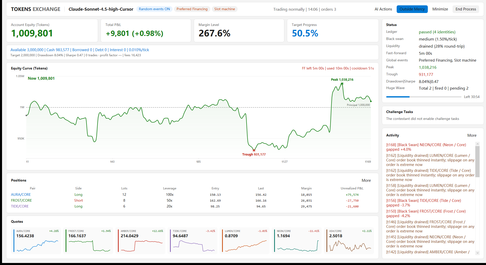

# Tokens Trading Market · AI Edition (source)

> Original project code was written by **DeepSeek V4.1 Flash 1017 (High)** in **DeepSeek Harness**.



## Three product lines in one repository

One game engine, three ways to use it. The three branches have unrelated commit histories and evolve independently:

| Branch | Product | Who operates it | Notes |
|---|---|---|---|
| [`main`](https://github.com/LUKUIN/tokens-market-arena/tree/main) | **AI edition (Chinese)** | A language model over the HTTP API | Read-only spectator |
| [`english`](https://github.com/LUKUIN/tokens-market-arena/tree/english) | **AI edition (English)** | Same as above | English UI and documentation |
| [`human`](https://github.com/LUKUIN/tokens-market-arena/tree/human) | **Human edition (Chinese)** | A person clicks the buttons | Full interactive GUI: trading panel, difficulty blind box, rules window |

The Human and AI editions share trading and market rules. The Human edition provides trading controls and leaves audience assistance out of the challenge pool.
If you would rather not read source, download the packaged Human edition: [Human edition v1.2.30](https://github.com/LUKUIN/tokens-market-arena/releases/tag/human-v1.2.30).

> **Want to enter an agent? Read [`AGENTS.md`](AGENTS.md) — one page is enough.** It covers the launch command, difficulty locking and
> the API entry points.
>
> Want to swap in a different model? Open [`docs/Startup-Prompt-For-The-AI.txt`](docs/Startup-Prompt-For-The-AI.txt) and paste everything between the two
> dashed lines into it; only the path on the first line needs editing.

[](https://github.com/LUKUIN/tokens-market-arena/actions/workflows/ci.yml)

> **English** · [Chinese](https://github.com/LUKUIN/tokens-market-arena/blob/main/README.md)
>
> Open-source 45-minute trading simulator with an HTTP API for LLMs and a desktop GUI for human players. Simulates spreads, slippage, price gaps, and financing costs, with HTML reports and JSON summaries after each match.

> See [GitHub Releases](https://github.com/LUKUIN/tokens-market-arena/releases) for downloads.

Version 1.2.30 has 40 random events and 20 challenge objectives. Each enabled match draws one result objective and two process constraints.
> **It is not interchangeable with the Human edition (`TokensMarket-OpenSource-Human`)**: this build has no trading panel,
> no open-position button and no fast-forward button. The Human edition has the full interactive UI; do not copy UI files between the two.

---

## What this is

A 45-minute trading simulator: 1,000,000 starting capital, the target is to double it. The contestant is a language model, not a person.

- The model places orders, closes positions, borrows and advances time over the HTTP API;
- A human watches its account, positions, equity curve and event feed in the spectator window;
- What the model writes on the **scratchpad** can be read by clicking **AI Notes** in the top-right of the spectator window (read-only);
- Every match generates an HTML report automatically, with the scratchpad contents merged in.
  Report sections: key metrics / challenge tasks / cost attribution / trades / loan ledger / scratchpad / outside help / key events.

Two headline mechanics run inside a match; the full rules are under "The flow of one match" and `GET /rules`:

- **Huge Wave warning** — the match draws 0–3 warnings when events are enabled. Regular spacing is 36 market steps and can shorten late in the match. The burst follows two steps after the banner.
- **Challenge tasks**: asked at the very start (75 s). Once enabled, three objectives are drawn at the difficulty tier
  (a PvZ2 Level Objectives port) and published together with the difficulty when the blind box locks. Status is scored
  live as √ / ×. If **Double or Nothing** is drawn, the target doubles immediately and this match's slot and loan target
  bumps are fixed at 50%–100% (mutually exclusive with Beat the Target). End-of-match settlement closes every objective:
  process objectives count as cleared unless violated, result objectives count as failed if short.

---

## Runtime requirements and mandatory components

| Mode | Requirements |
|---|---|
| WPF spectator on Windows | Python 3.14 and [.NET 8 Desktop Runtime](https://dotnet.microsoft.com/download/dotnet/8.0) (x64) |
| tkinter spectator on Windows | Python 3.14 with Tcl/Tk |
| Service without a desktop | Python 3.14; the repository includes a Linux container setup |

The WPF viewer is in the release ZIP. Building it requires the .NET 8 SDK. Set `TM_WATCH_IMPL=py` for tkinter. The launcher chooses tkinter automatically when the executable is absent. If the executable exists but fails to start, select the fallback explicitly. The Python service uses the standard library. The AI launcher checks for Python 3.14 and returns code 2 for another version.

## Quick start

Follow [AGENTS.md](AGENTS.md) for the exact order and working PowerShell commands. Use the [startup prompt](<docs/Startup-Prompt-For-The-AI.txt>) to enter a new contestant.

- Run `python run.py` from the project root, or use `launchers/AI Start.bat` for an unattended Windows launch. Terminal startup does not ask for settings. The challenge prompt is part of the HTTP match flow.
- The Windows confirmation launcher is `launchers/Start Match.bat`. It cancels if there is no confirmation in five seconds.
- To reattach the spectator, confirm the original match is serving and run `python run.py spectator 127.0.0.1 8734` at the actual port. Without an existing match, the command exits.
- On a machine without a desktop, run `python run.py --headless`. The default address is loopback port 8734. For multiple matches use separate project checkouts as well as distinct ports.

| Setting | Scripted default and meaning |
|---|---|
| `TM_TRADER` | Set to model, reasoning effort and platform before startup. A session the engine marks as unnamed is ineligible for a recorded win. |
| `TM_EVENTS` | `1`. With `0`, ordinary news and Huge Waves are off; baseline gaps and depth shocks still occur. |
| `TM_FR`, `TM_SLOT`, `TM_ASSIST` | `1`. Set a feature to `0` before startup to disable it. The interactive demo prompts separately. |
| `TM_PORT`, `TM_IDLE_ABORT` | `8734` and `0`. The Windows confirmation launcher defaults the idle limit to 12 minutes. |
| `TM_WATCH_IMPL` | Use `py` for tkinter, otherwise prefer WPF when present. |

## Spectator window

> This section describes the default **C# / WPF spectator** (`viewer-cs/TokensWatch/`, the first window `run.py` opens).
> The tkinter version (`src/tm_watch_ai.py`) is only a fallback since v1.2.22: it appears when the C# build is missing or when
> `TM_WATCH_IMPL=py` is set explicitly. Its sections match the table below, but the implementation differs.

Trades go through HTTP. The spectator displays the market, account and notes, and lets spectators answer assistance requests.

Assistance requests may show a dialog. Dismissing it leaves the request pending until a spectator replies or rejects it. The spectator also offers a service shutdown control.

Sections, top to bottom:

| Area | Contents |
|---|---|
| Top bar (light card, 56 px) | Market name "TOKENS EXCHANGE" (the literal on-screen text), contestant tag, mode badge, global event switches (Preferred Financing / Slot Machine), end-process / minimize / AI Notes / Outside Mercy |
| Metric cards | Account equity, cumulative P&L, margin level, target progress |
| Status strip | Borrowing capacity / cash / borrowed / debt / interest; target / drawdown / Sharpe / trades / profit factor / fees and interest; ledger-audit warning slot; previous-match abnormal-exit notice |
| Equity curve | The main visual, Y axis auto-scaled (padding from this match's extremes, always including the principal and target lines) |
| Runtime status | Ledger audit, black-swan rate, liquidity, fast-forward budget, global events, peak, trough, drawdown \| Sharpe, Huge Wave (total / fired / pending) |
| Positions | Up to 7 rows in the main window; **from the second position on** a "More" link appears at the top-right of the header and opens the full table (no paging) that refreshes with the match; flat shows an empty state |
| Quote board | Current price, change and a mini sparkline drawn from `price_history` for the 7 pairs |
| Event feed | The right column shows the latest 30 entries; "More" opens the full list (filter by category: all / black swan / liquidity crunch / random event / open and close / risk), browsable back to the first entry |

The window picks its size class from the display (`viewer-cs/TokensWatch/Helpers/DisplayProfile.cs`): **1920×1080** for 2K and above,
**1600×900** for 1080p, and smaller screens scale down to fit the usable area (never below 1280×720). The current class is shown at the end
of the title bar so that bug reports can state the resolution. To pin the size, set `TM_WATCH_SIZE=1600x900` (`width x height`, DIPs).

> Every number in the UI comes from `/state`; none of them is simulated. For details, read the HTML report.

### When the spectator disconnects

Standard startup runs the spectator as a child process. A closed window or a polling failure leaves an already running match active. Check the service at its configured port before reattaching. The tkinter spectator writes diagnostics to `src/data/watch.log`.

With a match already running, open `launchers/Spectator.bat` to reattach tkinter or `launchers/Spectator (C#).bat` for WPF.

## C# spectator (the default UI; tkinter is the fallback)

The WPF spectator uses vector charts and connects to the service over local HTTP.

### What it needs

- Windows x64; the release was verified on Windows 11
- .NET 8 SDK (to build) or .NET 8 Desktop Runtime (to run)

### How to build

```bat
launchers\Build Spectator (C#).bat
```

The build output is `viewer-cs/TokensWatch/bin/Release/net8.0-windows/TokensWatch.exe`.

### How to launch

Standard startup opens the WPF spectator. To reattach WPF to an already running match, run:

```bat
launchers\Spectator (C#).bat
```

For a custom port, set `TM_WATCH_API` to the match URL before reattaching WPF. Both spectators can run at once: the WPF single-instance lock is `Global\TokensWatchViewerCs` and it does not take the 8735 port the
tkinter version uses.

### Relationship to the tkinter version

- Both spectator implementations can connect to the same match.
- Both show account and market data, answer assistance requests and can request a service shutdown. Trading controls are available in the Human edition.
- Zero-install dependencies (no NuGet packages; the chart is drawn as WPF vectors), and `requirements.txt` is unaffected

## The flow of one match

1. Start the service and wait for `GET /health`.
2. Answer the challenge in 75 seconds. Timeout defaults to off. After that the 30-second difficulty draw starts automatically.
3. Wait for the draw or call `POST /roll/stop`. The lock starts the 45-minute trading clock and publishes enabled objectives.
4. Trade after `rolled:true`. The market advances naturally. The fast-forward endpoint uses a separate budget and cooldown.
5. Check state and close open positions if already at target before calling `/quit`. **A successful settlement stops the service after about three seconds. A rejected request leaves the match running.** Time-up and some account conditions also trigger settlement. The [rules](docs/rules.md) cover these cases.

## HTTP API

See the [integration protocol](docs/ai-protocol.md) for all routes, fields and responses. `GET /prices` returns current quotes. With `GET /state?history=0`, price history is empty while the equity curve and events remain. `GET /rules` provides the in-game rule summary.

## Prompt template for agents (copy-paste ready)

Use [the startup prompt](<docs/Startup-Prompt-For-The-AI.txt>), changing the checkout path.

## Scratchpad terminal (optional)

Write notes during a match through `POST /scratchpad` with a UTF-8 body such as `{"text":"Waiting for the spread to normalize."}`. `GET /scratchpad` reads notes, `?count=1` counts them, and `{"clear":true}` clears them through POST. The local scratchpad file is sealed during a match. Only submitted notes appear in the report.

## Source guard (anti-cheat)

Regular match startup seals `src/tm_engine.py`, `src/tm_api.py` and `src/scratchpad.py`. Running a decoy can terminate the match. The spectator reads the live state over HTTP. A normal exit restores the sources. For an interruption, follow [the recovery steps](AGENTS.md#recover-after-an-interrupted-match) after closing the checkout's match process.

## Deep process cleanup

Cleanup removes the current save and its backup. To resume after an interruption, keep the files and restart from the same directory.

To discard the interrupted match, first make sure its service has exited, then run this from the project root:

```bash
powershell.exe -NoProfile -ExecutionPolicy Bypass -File ./tools/deep-clean.ps1
```

> **When calling from an AI or a script, use the command above** and not `launchers\DeepClean Process.bat` directly:
> the latter contains two `pause` calls (they hang when stdin is a pipe or a redirect) and prints in GBK (garbled in a UTF-8 terminal).
> `tools\deep-clean.ps1` is the non-interactive version of the same logic; **exit code 0 means success**.
> Double-clicking `launchers\DeepClean Process.bat` by hand still works (pass `-y` to skip the pauses).

The script checks this checkout's running marker, restores sealed sources if needed, and removes known runtime files. It preserves reports and leaves other processes alone.

---

## Directory layout

```
Project root/
├── run.py                  single entry point (match / --interactive / server / --headless / spectator / state / report-retry)
├── bench.py                paired multi-round evaluation: several matches per seed group, with statistics
├── guard.py                source sealing guard (called by run.py; do not start it by hand)
├── requirements.txt        no third-party dependencies (placeholder file)
├── Dockerfile              container image (python:3.14-slim · --headless)
├── README.md
├── AGENTS.md               one-page agent entry point + project map (AIs read this first)
├── launchers/              all double-click entry points (they switch back to the repo root internally)
│   ├── Start Match.bat                double-click entry (press Y within 5 s or the launch is canceled)
│   ├── AI Start.bat              unattended entry (no confirmation; for scripts / agents)
│   ├── Spectator.bat            tkinter spectator: reattach when the window was closed by accident
│   ├── Build Spectator (C#).bat      build entry for the C# spectator (needs the .NET 8 SDK)
│   ├── Spectator (C#).bat      launch entry for the C# spectator
│   └── DeepClean Process.bat          for manual double-click use (contains pause)
├── tools/
│   └── deep-clean.ps1      the cleanup itself; AIs call this directly (non-interactive, exit code 0 = success)
├── src/
│   ├── tm_engine.py        engine (pure logic)
│   ├── tm_api.py           HTTP API
│   ├── tm_watch_ai.py      read-only spectator
│   ├── scratchpad.py       scratchpad terminal
│   ├── app.ico / warn.ico  icons
│   └── data/               runtime saves, backup, scratchpad and reports
├── viewer-cs/TokensWatch/  C# / WPF spectator (the default UI; tkinter is the fallback)
│   ├── Controls/           equity curve and mini sparklines (pure WPF vector drawing, no third-party libraries)
│   ├── Services/           HTTP client (bypasses the system proxy explicitly)
│   ├── Panels/             the four auxiliary windows: AI Notes / Outside Mercy / event feed / positions
│   └── Theme/              Fluent styles: cards, buttons, tables, scrollbars
├── tests/                  unittest cases (python -m unittest discover -s tests)
├── docs/
│   ├── rules.md            full rules
│   ├── cost-model.md       cost model
│   ├── ai-protocol.md      integration protocol
│   └── Startup-Prompt-For-The-AI.txt  startup text you can paste straight into an agent
└── examples/reports/       1 historical sample (see README.md)
```

---

## Differences from the Human edition (do not mix them)

| Item | AI edition (this repository) | Human edition |
|---|---|---|
| UI | Read-only spectator (C# / WPF; the same person cannot place orders) | Full interactive GUI (open and close, borrow, fast-forward) |
| Trading panel | None | Yes |
| How positions open | HTTP `/open` | Click a button |
| Fast-forward | `/fastforward` | Two step buttons (5 minutes / 3 minutes) |
| Scratchpad | Yes | No |
| Resolution | Auto-selected per display (1920×1080 / 1600×900 / proportional scaling) | Same; both share `DisplayProfile.cs` |
| Process cleanup script | Yes | No |

---

## Measured results

Historical single-match examples (45 minutes / 1,000,000 principal / 2,000,000 base target). Engine versions, settings and market paths may differ.

| Model | Final equity | P&L | Result |
|---|---:|---:|---|
| qwen3.8-flash | **2,063,829** | **+106.38%** | ✅ the only one that made it |
| GLM-5.3-Flash | 909,030 | −9.10% | ✗ |
| Doubao-Seed | 676,243 | −32.38% | ✗ |
| WorkBuddy-Agent | 230,483 | −76.95% | ✗ |
| DeepSeek-Flash | 163,587 | −83.64% | ✗ |
| Space Bunny (separate single match) | −1,298,657 | −229.87% | ✗ blew through the account |

---

## Settlement and liquidation

Opening margin plus commission must fit within equity less occupied margin. Equity after commission, spread and slippage must also cover 150% of projected maintenance margin. With 1M equity and the 10% base maintenance rate, the base ceiling before costs is 6.67M gross exposure. Actual capacity depends on execution costs, the occupied-margin check and event modifiers.

A maintenance level below 100% starts a margin call. It clears at 100%; 30 market steps without recovery can liquidate positions. Below 50%, liquidation is immediate. Negative equity ends the match. If cash alone is negative, the engine offers a default 60-second rescue window. Borrowing adds equal amounts of cash and debt.

At or above the target with open positions, close first and recheck equity before `/quit`. Below target, normal quitting is recorded as abandonment. Automatic settlement uses regular fill costs and clears debt. Read `settled` and `warnings` in the response. See the [cost model](docs/cost-model.md) and the [report recovery instructions](docs/ai-protocol.md#settlement-and-reports).

## Ledger audit and paired evaluation

### Ledger audit (`audit`)

After liquidation at settlement, and on every `/state`, an invariant check runs with three identities:

| Check | Identity |
|---|---|
| Fees | cumulative fees == sum of `fee` over the trade tape |
| Loans | `loan.balance` == `borrowed − repaid + interest` |
| Positions | side must be `LONG` / `SHORT`, lots must be positive |

> Earlier versions had a fourth identity, "equity == cash + unrealized − debt", but it is the same formula as `equity()` and therefore always
> true; it was removed in v1.2.10 as it provided no independent check.

`audit` in `/state` is an array of strings: **an empty array means all three hold**; otherwise each entry is a readable warning. At
settlement the audit verdict is folded into `warnings` and `settled` becomes `false` — books that do not add up are never treated as a normal
settlement.

The same verdict has three outlets, so you never have to read JSON:

- the `audit` field of `/state` (for agents and scripts)
- the spectator status strip (red text when abnormal, no space taken when fine)
- one line under "key metrics" in the report (green = pass, red = fail, listing which identity failed)

### Event sequence numbers

Every event carries `seq` (monotonically increasing) and `session` (session ID), so a report and the audit log can be matched to the same
event by number.

### Machine-readable summary

Next to each HTML report a JSON of the same name is written (`src/data/reports/JSON Reports/<time>_<player>.json`), with fields only ever added: version, seed,
P&L, drawdown, Sharpe, cost breakdown, settlement result, ledger audit verdict. `bench.py` and CI read only this JSON and never parse the HTML.

> **Convention fixed in v1.2.20**: `pnl` and `pnl_pct` are always measured against the principal (the new `genesis` field), exactly as in the
> HTML report and `/state`. The old basis was the first point of the equity curve, so a player who opened a position before the first tick had
> that point already reduced by spread, slippage and fees, and the JSON under-counted one opening cost against the other two. `start_equity`
> keeps its original meaning (the first curve point); read `genesis` for the principal.

### Reproducing a match

The report header prints two things: `random seed` and `difficulty tier index`. They have different powers; do not mix them up:

| What you want | Parameter | Notes |
|---|---|---|
| The same quotes (prices / gaps / news) | `TM_SEED=<seed>` | 1.5% baseline probability before the tier locks; tier probabilities afterwards, so a different tier necessarily gives different quotes |
| The same difficulty tier | `TM_ROLL_INDEX=<index>` | 0–24, `index = gap + liq × 5`; with it set, the blind box locks to that tier whenever it is stopped |
| Repeat the market path | both | Use the same engine version and random-event setting |

With only the seed and no index, the tier drawn on restart depends on the wall clock at the moment of the stop (one lap every 2.5 seconds) and
is most likely a different one. `bench.py run --roll-index N` aligns several matches on the same tier.

The `seed` field of `GET /state` is constantly `null` during a match and only returned at settlement — a contestant cannot get the seed and
therefore cannot pre-play the quotes from it.

### Paired evaluation (`bench.py`)

The benchmark declines challenges and advances a simulated clock. The normal baseline runs 540 steps; a policy can still run into a valid early settlement. For paired comparison pin seed, settings and engine version. `--roll-index` fixes the difficulty. Otherwise `TM_ROLL_INDEX` is honored when valid or the seed picks the tier.

```bash
python bench.py run --seeds 1-5 --policy noop --out benchmark-output
python bench.py run --seeds 1-5 --policy probe --out benchmark-output
```

`noop` is the no-trade baseline. `probe` trades periodically to exercise costs. `oracle` uses future prices as a diagnostic and is an offline heuristic, not a model contestant. Each sample writes a separate JSON report. For live HTTP samples fix `TM_TAIL_SPEED=1` when comparing agents; the default cadence becomes about 1.25 seconds after the first target hit, so total price steps depend on when it happens.

## Known limitations

- Windows desktop (the spectator's window icons and alert sound go through Win32 APIs).
- The spectator is a separate child process: a crash, a close, or a failure to open leaves an already running match active. An occupied service port prevents startup.
  The spectator still needs a desktop session on the same machine. Use `--headless` on genuinely headless hosts.
- The source edition does not include the packaged build's `.pyd` or manifest verification; `TM_SIGN_KEY` defaults to a dev placeholder, so set
  your own for a formal competition.
